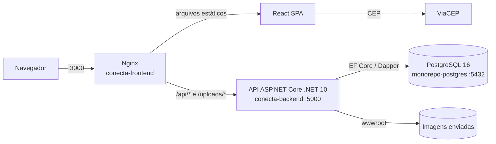

# Conecta Construções

Plataforma web que conecta clientes a prestadores de serviços da construção civil e manutenção residencial: pedreiros, eletricistas, encanadores, pintores, gesseiros e outros profissionais autônomos de Tupã-SP e região.

| | |
|---|---|
| **Projeto** | Projeto Integrador de Sistemas Inteligentes – 4º termo · Fatec "Shunji Nishimura" – Pompeia |
| **Equipe** | Grupo 4 – Luana Beatriz Ribeiro Abrantes, Gabriel Roberto Rodella de Assis, Vinicius Rodrigues Marquesin, Joice Soato Brito, Douglas Mariano e Cleiton Guilherme Rodrigues de Souza |
| **Versão** | Versão 02/2026 – candidata à apresentação · branch `main` (merge do PR #7, commit `a67d9a1`, 23/11/2026) |

---

## Sumário

1. [Visão geral](#1-visão-geral)
2. [Funcionalidades](#2-funcionalidades)
3. [Arquitetura](#3-arquitetura)
4. [Tecnologias e versões](#4-tecnologias-e-versões)
5. [Estrutura de pastas](#5-estrutura-de-pastas)
6. [Como executar](#6-como-executar)
7. [Configuração](#7-configuração)
8. [Dados de demonstração](#8-dados-de-demonstração)
9. [API](#9-api)
10. [Testes](#10-testes)
11. [Limitações e próximos passos](#11-limitações-e-próximos-passos)
12. [Solução de problemas](#12-solução-de-problemas)

---

## 1. Visão geral

Hoje, quem precisa de um serviço de obra ou reparo depende de indicação, e o profissional autônomo tem pouca visibilidade e nenhum lugar organizado para mostrar o seu trabalho. O Conecta Construções reúne os dois lados em uma única plataforma, com três perfis de uso:

| Perfil | O que faz |
|---|---|
| **Cliente** | Busca profissionais por categoria e distância, vê vitrine, portfólio e avaliações, pede orçamento com fotos, aceita propostas, conversa pelo chat e avalia o serviço concluído |
| **Prestador (Conecta PRO)** | Mantém perfil, bio e portfólio, define disponibilidade, recebe solicitações, envia propostas ou recusa, acompanha pedidos e métricas no painel |
| **Administrador** | Gerencia usuários, perfis de acesso e bloqueios, aprova ou rejeita documentos de prestadores e modera denúncias |

**Jornada principal:** busca → solicitação de orçamento → proposta → aceite e pedido → chat → conclusão → avaliação.

---

## 2. Funcionalidades

### Cliente
- Cadastro com preenchimento de endereço pelo CEP (ViaCEP) e login com JWT.
- Busca de prestadores por categoria e raio em km, com distância e nota.
- Perfil do prestador: bio, categorias, portfólio com imagens, avaliações e favoritos.
- Solicitação de orçamento com descrição e fotos.
- Meus Pedidos: acompanhamento das solicitações, propostas recebidas e pedidos.
- Aceite da proposta e confirmação do pedido.
- Chat por pedido e caixa de mensagens com contador de não lidas.
- Avaliação com nota e comentário, permitida apenas para pedidos concluídos.

### Prestador (Conecta PRO)
- Painel com métricas, agenda e status de disponibilidade.
- Análise de solicitações recebidas, com envio de proposta (itens, valor e prazo) ou recusa.
- Gestão de portfólio com upload de imagens.
- Meus Serviços: acompanhamento e conclusão de pedidos.
- Mensagens com os clientes.

### Administrador
- Painel com resumo da plataforma.
- Lista, detalhe e edição de usuários, com bloqueio e desbloqueio.
- Atribuição de perfis de acesso (roles).
- Aprovação ou rejeição de documentos de prestadores.
- Moderação de denúncias.

---

## 3. Arquitetura

### 3.1 Visão geral



1. O navegador carrega a aplicação React servida pelo **Nginx**.
2. Cada ação da tela vira uma requisição HTTP para `/api/...`, com o token JWT no cabeçalho `Authorization: Bearer`.
3. O Nginx repassa `/api/` e `/uploads/` para o contêiner da API. Assim, front-end e API ficam na mesma origem para o navegador.
4. A **API** valida o token, confere o perfil do usuário, aplica as regras de negócio e grava ou lê no **PostgreSQL**.
5. As imagens enviadas (portfólio e solicitações) são gravadas em `wwwroot` e servidas pela própria API.

### 3.2 Back-end em camadas

A solução `Conecta.slnx` segue uma arquitetura em camadas:

```text
Conecta.API             → Controllers HTTP e Program.cs (DI, JWT, CORS, Swagger, arquivos estáticos, migrações)
   ↓
Conecta.Application     → Serviços de aplicação (regras de negócio), DTOs e segurança (TokenService, PasswordHasher)
   ↓
Conecta.Domain          → Entidades, enums de status e interfaces de repositório
   ↑
Conecta.Infrastructure  → AppDbContext (EF Core), repositórios, DbConnectionFactory (Dapper) e migrações Evolve
```

| Camada | Conteúdo principal |
|---|---|
| **API** | 13 controllers de negócio: `Auth`, `Usuarios`, `Categorias`, `Prestadores`, `Portfolio`, `Solicitacoes`, `Pro`, `Pedidos`, `Conversas`, `Avaliacoes`, `Admin`, `Roles` e `Permissoes` |
| **Application** | Serviços `AuthService`, `UsuarioService`, `PrestadorService`, `SolicitacaoService`, `ProService`, `PedidoService`, `ChatService`, `AvaliacaoService`, `AdminService`, `RoleService`, `PermissaoService` e `CategoriaService`, cada um com sua interface |
| **Domain** | Entidades (`Usuario`, `Cliente`, `Prestador`, `Solicitacao`, `Proposta`, `Pedido`, `Conversa`, `Avaliacao`, `Denuncia`...), enums mapeados para enums nativos do PostgreSQL e interfaces `I*Repository` |
| **Infrastructure** | `AppDbContext`, repositórios concretos, `EvolveDatabaseMigrator` e scripts SQL de migração |

A injeção de dependência é registrada no `DependencyInjection.cs` de cada camada e montada no `Program.cs`.

### 3.3 Autenticação e autorização

- **Login:** `POST /api/v1/auth/login` valida e-mail e senha e devolve um **JWT** assinado com HMAC-SHA256, válido por 24 horas.
- **Claims do token:** id, nome, e-mail, roles e permissões do usuário.
- **Senhas:** hash **PBKDF2-SHA256** com salt e 100.000 iterações (`PasswordHasher`).
- **Autorização na API:** as rotas protegidas usam `[Authorize]`. As rotas administrativas exigem a role `ADMIN_MASTER`, e algumas consultas também aceitam `SUPORTE` e `ANALISTA`.
- **Roles cadastradas:** `CLIENTE`, `PRESTADOR`, `ADMIN_MASTER`, `SUPORTE`, `MODERACAO`, `FINANCEIRO` e `ANALISTA`, ligadas a permissões por recurso e ação (`role_permissoes`).
- **No front-end:** o token fica no `localStorage`, e o `SessionContext` guarda o usuário e o perfil ativo. As rotas são protegidas pelo componente `RequirePerfil` (`CLIENTE`, `PRESTADOR` ou `ADMIN`), e um usuário com mais de um perfil pode alternar entre eles.

### 3.4 Banco de dados

**PostgreSQL 16**, com **28 entidades** mapeadas no `AppDbContext`, organizadas por domínio:

| Domínio | Tabelas principais |
|---|---|
| Usuários e acesso | `usuarios`, `telefones`, `roles`, `permissoes`, `role_permissoes`, `usuario_roles`, `audit_log` |
| Localização | `estados`, `cidades`, `enderecos` (com latitude e longitude) |
| Perfis | `clientes`, `prestadores`, `documentos_cliente`, `documentos_prestador`, `favoritos` |
| Catálogo e vitrine | `categorias`, `portfolios`, `portfolio_imagens` |
| Negociação | `solicitacoes`, `solicitacao_imagens`, `propostas`, `proposta_itens`, `pedidos` |
| Comunicação | `conversas`, `mensagens`, `mensagem_anexos` |
| Reputação e moderação | `avaliacoes`, `denuncias` |

- **Enums nativos** do PostgreSQL guardam os status (solicitação, proposta, pedido, disponibilidade, conta, documento e denúncia) e são mapeados pelo Npgsql.
- **Migrações versionadas com Evolve** são aplicadas automaticamente quando a API inicia:
  - `V1_0__Initial_Schema.sql`: estrutura inicial.
  - `V2_0__Evolucao_Modelagem_Completa.sql`: modelagem completa, roles e permissões.
- **Acesso a dados:**
  - **EF Core** cuida da maior parte das operações (CRUD e relacionamentos).
  - **Dapper** executa a **busca geoespacial** de prestadores. A consulta SQL calcula a distância esférica entre o cliente e o prestador (raio da Terra de 6.371 km) e compara o raio pedido pelo cliente com o raio de atendimento do prestador.

**Ciclo de negócio:**

```text
Solicitação → Proposta do prestador → aceite pelo cliente → Pedido → confirmação (AGENDADO) → CONCLUIDO → Avaliação
                     ↘ recusa                                              ↘ CANCELADO
```

### 3.5 Front-end

SPA em **React 19 + TypeScript**, compilada com **Vite** e roteada com **React Router**.

| Pasta | Conteúdo |
|---|---|
| `src/routes` | Definição das rotas e proteção por perfil (`RequirePerfil`) |
| `src/pages` | Telas do cliente (Home, Busca, PrestadorPerfil, MeusPedidos, PedidoDetalhe, ChatPedido, Mensagens), além de `pro/` e `admin/` |
| `src/features` | Módulos por domínio (`cliente`, `pro`, `admin`, `pedidos`, `portfolio`) com os serviços que chamam a API |
| `src/core` | Cliente HTTP (`api/http.ts`), layouts (Cliente, PRO e Admin), componentes de UI, hooks e utilitários |
| `src/context` | `SessionContext` (usuário, token e perfil) e `ChatContext` (conversas e mensagens não lidas) |
| `src/components` | Componentes compartilhados de chat, portfólio e sessão |

O cliente HTTP (`core/api/http.ts`) centraliza a URL base (`/api/v1`, configurável por `VITE_API_URL`), anexa o token JWT e converte os erros da API em `ApiError`.

### 3.6 Contêineres (Docker Compose)

| Serviço | Contêiner | Imagem / build | Porta |
|---|---|---|---|
| `postgres` | `monorepo-postgres` | `postgres:16-alpine`, com healthcheck e volume `postgres_data` | 5432 |
| `backend` | `conecta-backend` | Build multi-stage: `.NET SDK 10` → `aspnet:10.0` | 5000 |
| `frontend` | `conecta-frontend` | Build multi-stage: `node:22-alpine` → Nginx | 3000 → 80 |
| `redis` | `monorepo-redis` | `redis:7-alpine`, reservado para uso futuro | 6379 |

A API só inicia depois que o PostgreSQL passa no healthcheck. Todos os serviços ficam na rede `monorepo-network`.

---

## 4. Tecnologias e versões

| Área | Tecnologia | Versão |
|---|---|---|
| Front-end | React / React DOM | 19 |
| | React Router | 7 |
| | TypeScript | 6 |
| | Vite | 8 |
| | Nginx | imagem oficial |
| Back-end | .NET / ASP.NET Core | 10 |
| | JWT Bearer | 10.0 |
| | Swashbuckle (Swagger) | 10.2 |
| Dados | PostgreSQL | 16 |
| | Npgsql e Npgsql.EntityFrameworkCore.PostgreSQL | 10.0 |
| | Dapper | 2.1 |
| | Evolve | 3.2 |
| Testes | xUnit / Moq | 2.9 / 4.21 |
| Infraestrutura | Docker e Docker Compose | atual |
| Serviço externo | ViaCEP | API pública |

---

## 5. Estrutura de pastas

```text
Conecta-Construcoes/
├── README.md
├── doc/
│   └── System_Design.md                 # Visão e regras de negócio do produto
└── Conecta/
    ├── docker-compose.yml               # PostgreSQL, Redis, API e front-end
    ├── seed_teste_local.sql             # Dados de demonstração
    ├── apps/ConectaConstrucoes/
    │   ├── backend/
    │   │   ├── Conecta.slnx
    │   │   ├── Dockerfile
    │   │   ├── Conecta.API/             # Controllers, Program.cs, appsettings
    │   │   ├── Conecta.Application/     # Serviços, DTOs e segurança
    │   │   ├── Conecta.Domain/          # Entidades, enums e interfaces
    │   │   ├── Conecta.Infrastructure/  # DbContext, repositórios e migrações
    │   │   └── Conecta.Tests/           # Testes xUnit
    │   └── frontend/
    │       ├── Dockerfile
    │       ├── nginx.conf               # SPA + proxy /api e /uploads
    │       └── src/                     # routes, pages, features, core, context, components
    └── servicos-compartilhados/         # Autenticacao.API e AuditoriaLog.Service (fora do Compose)
```

---

## 6. Como executar

### 6.1 Com Docker (recomendado)

**Pré-requisitos:** Git e Docker Desktop em execução.

```bash
# 1. Baixar o código
git clone https://github.com/VMarquesin/Conecta-Construcoes.git
cd Conecta-Construcoes/Conecta

# 2. Limpar execuções anteriores (apaga o banco local)
docker compose down -v

# 3. Construir e subir os serviços
docker compose build --no-cache
docker compose up -d

# 4. Aguardar a API aplicar as migrações
docker logs -f conecta-backend
#    quando aparecer "Now listening on: http://[::]:5000", pressione Ctrl+C

# 5. Carregar os dados de demonstração
docker cp seed_teste_local.sql monorepo-postgres:/seed_teste_local.sql
docker exec -i monorepo-postgres psql -U admin -d monorepo_db -f /seed_teste_local.sql
```

| Acesso | Endereço |
|---|---|
| Aplicação | http://localhost:3000 |
| API | http://localhost:5000 |
| Swagger | http://localhost:5000/swagger |
| PostgreSQL | `localhost:5432` · banco `monorepo_db` · usuário `admin` · senha `admin123` |

**Para parar:** `docker compose down` mantém os dados, e `docker compose down -v` apaga o banco.

> No Windows, rode os comandos no PowerShell dentro da pasta `Conecta`. O passo 5 copia o arquivo para dentro do contêiner para preservar os acentos.

### 6.2 Modo de desenvolvimento

**Pré-requisitos:** .NET SDK 10, Node.js 22 e npm.

```bash
# Banco em contêiner
docker compose -f Conecta/docker-compose.yml up -d postgres

# API (http://localhost:5078, Swagger em /swagger)
cd Conecta/apps/ConectaConstrucoes/backend
dotnet run --project Conecta.API/Conecta.API.csproj

# Front-end (http://localhost:5173)
cd Conecta/apps/ConectaConstrucoes/frontend
npm ci
npm run dev
```

---

## 7. Configuração

### Variáveis do Docker Compose

| Variável | Padrão | Uso |
|---|---|---|
| `POSTGRES_USER` / `POSTGRES_PASSWORD` / `POSTGRES_DB` | `admin` / `admin123` / `monorepo_db` | Credenciais e nome do banco |
| `POSTGRES_PORT` | `5432` | Porta do PostgreSQL |
| `BACKEND_PORT` | `5000` | Porta da API |
| `FRONTEND_PORT` | `3000` | Porta da aplicação |
| `REDIS_PORT` | `6379` | Porta do Redis |
| `ASPNETCORE_ENVIRONMENT` | `Development` | Ambiente da API |

### API (`appsettings.json` ou variáveis de ambiente)

| Chave | Uso |
|---|---|
| `ConnectionStrings__DefaultConnection` | Conexão com o PostgreSQL (no Docker, definida pelo Compose) |
| `Jwt__SecretKey` / `Jwt__Issuer` / `Jwt__Audience` | Assinatura e validação do token JWT |

### Front-end

| Variável | Padrão | Uso |
|---|---|---|
| `VITE_API_URL` | `/api/v1` | URL base da API |

---

## 8. Dados de demonstração

O arquivo `seed_teste_local.sql` cria usuários, prestadores, categorias, portfólios, solicitações, pedidos e avaliações fictícios. Todas as contas usam a senha **`admin123`**.

| Perfil | Nome | E-mail |
|---|---|---|
| Administrador | Admin Master Conecta | admin@conecta.com |
| Cliente | Matheus Oliveira | matheus@conecta.com |
| Cliente | Mariana Lopes | mariana@conecta.com |
| Cliente | Fernanda Castro | fernanda@conecta.com |
| Prestador | Carlos Silva (Eletricista) | carlos@conecta.com |
| Prestador | Roberto Almeida (Encanador) | roberto@conecta.com |
| Prestador | Lucas Mendes (Pintor) | lucas@conecta.com |
| Prestador | Juliana Ramos (Alvenaria) | juliana@conecta.com |
| Prestador | Marcelo Silveira (Limpeza) | marcelo@conecta.com |

**Categorias:** Instalações Elétricas, Instalações Hidráulicas, Pintura e Acabamento, Reformas e Alvenaria, Limpeza Pós-Obra, Marcenaria e Planejados, Serralheria e Portões, Gesso e Drywall.

**Roteiro rápido:**
1. Entre como `matheus@`, busque Instalações Elétricas, abra o perfil de Carlos Silva e solicite um orçamento.
2. Entre como `carlos@` e envie a proposta.
3. Volte como `matheus@`, aceite e confirme o pedido e converse pelo chat.
4. Como `carlos@`, conclua o pedido.
5. Como `matheus@`, avalie o serviço.

---

## 9. API

Base: `http://localhost:5000/api/v1` (a maioria das rotas também responde em `/api/...`). A documentação completa e interativa está no **Swagger**: clique em **Authorize** e cole o token retornado pelo login.

| Recurso | Método e rota | Descrição |
|---|---|---|
| Auth | `POST /auth/login` | Login, devolve o JWT |
| Usuários | `POST /usuarios/registro` | Cadastro |
| | `GET /usuarios/me` | Dados do usuário logado |
| Categorias | `GET /categorias` | Lista de categorias |
| Prestadores | `GET /prestadores/busca` | Busca por categoria e raio |
| | `GET /prestadores/{id}` | Perfil e vitrine |
| | `POST` / `DELETE /prestadores/{id}/favorito` | Favoritar ou desfavoritar |
| Portfólio | `POST /portfolio/upload` | Upload de imagem |
| Solicitações | `POST /solicitacoes` | Cliente cria solicitação de orçamento |
| | `GET /solicitacoes/minhas` | Solicitações do cliente |
| PRO | `GET /pro/dashboard` | Métricas do prestador |
| | `GET /pro/solicitacoes` | Solicitações recebidas |
| | `POST /pro/solicitacoes/{id}/proposta` | Enviar proposta |
| | `POST /pro/solicitacoes/{id}/recusar` | Recusar solicitação |
| | `PATCH /pro/disponibilidade` | Alterar disponibilidade |
| Pedidos | `POST /pedidos/propostas/{propostaId}/aceitar` | Aceitar proposta e criar pedido |
| | `POST /pedidos/{id}/pagamento` | Confirmar pedido (status `AGENDADO`) |
| | `POST /pedidos/{id}/concluir` | Concluir pedido |
| | `POST /pedidos/{id}/cancelar` | Cancelar pedido |
| Conversas | `GET` / `POST /conversas/{id}/mensagens` | Ler e enviar mensagens |
| | `GET /conversas/nao-lidas/total` | Total de mensagens não lidas |
| Avaliações | `POST /avaliacoes` | Avaliar pedido concluído |
| Admin | `GET /admin/usuarios` | Listar usuários |
| | `POST` / `DELETE /admin/usuarios/{id}/bloqueio` | Bloquear ou desbloquear |
| | `GET /admin/documentos` | Documentos pendentes |
| Roles | `GET /roles` | Perfis de acesso e permissões |

**Exemplo com curl:**

```bash
TOKEN=$(curl -s -X POST http://localhost:5000/api/v1/auth/login \
  -H "Content-Type: application/json" \
  -d '{"email":"matheus@conecta.com","senha":"admin123"}' | jq -r .token)

curl -s http://localhost:5000/api/v1/solicitacoes/minhas -H "Authorization: Bearer $TOKEN"
```

---

## 10. Testes

**Back-end:** 14 testes xUnit com Moq em `Conecta.Tests`, cobrindo o serviço de usuários, o serviço de roles, o hash de senhas e o mapeamento dos enums.

```bash
cd Conecta/apps/ConectaConstrucoes/backend
dotnet test Conecta.slnx
```

**Front-end:** verificação de lint e de build.

```bash
cd Conecta/apps/ConectaConstrucoes/frontend
npm run lint
npm run build
```

---

## 11. Limitações e próximos passos

| Tema | Situação atual | Próximo passo |
|---|---|---|
| Pagamento | A confirmação do pedido muda o status para `AGENDADO` | Integrar Pix e cartão, com retenção do valor até a conclusão (Garantia Conecta Protege) |
| Implantação | Execução local com Docker | Publicar em nuvem com HTTPS e segredos protegidos |
| Cadastro de prestador | A tela cria contas de cliente, e os prestadores de demonstração vêm do seed | Cadastro de prestador pela tela, com envio de documentos para aprovação |
| Imagens | Gravadas em `wwwroot` dentro do contêiner da API | Armazenamento em nuvem |
| Testes | Testes unitários do back-end | Testes de integração e de ponta a ponta |
| Redis e serviços compartilhados | O Redis sobe no Compose sem uso, e `servicos-compartilhados` fica fora do Compose | Usar Redis como cache e integrar os serviços quando necessário |
| Segurança | Credenciais padrão, chave JWT em configuração e Swagger aberto, adequados só ao ambiente local | Trocar credenciais, usar variáveis de ambiente, restringir CORS e proteger o Swagger |
| Validação | Testes da equipe com personas | Pilotos com prestadores e clientes reais em Tupã-SP |

---

## 12. Solução de problemas

| Problema | Solução |
|---|---|
| Porta 3000, 5000 ou 5432 já em uso | Feche o programa que usa a porta ou altere `FRONTEND_PORT`, `BACKEND_PORT` ou `POSTGRES_PORT` |
| As contas de demonstração não entram | O seed não foi carregado: repita o passo 5 da seção 6.1 |
| Acentos estranhos (ex.: `Instala??es`) | Carregue o seed com `docker cp` + `psql`, não com pipe do PowerShell |
| A API não conecta ao banco | Aguarde o PostgreSQL ficar saudável e rode `docker compose restart backend` |
| Mudanças no código não aparecem | `docker compose build --no-cache` e depois `docker compose up -d` |
| Imagens do portfólio sumiram | O contêiner da API foi recriado: envie as imagens novamente |
| Começar do zero | `docker compose down -v` e repita a seção 6.1 |
